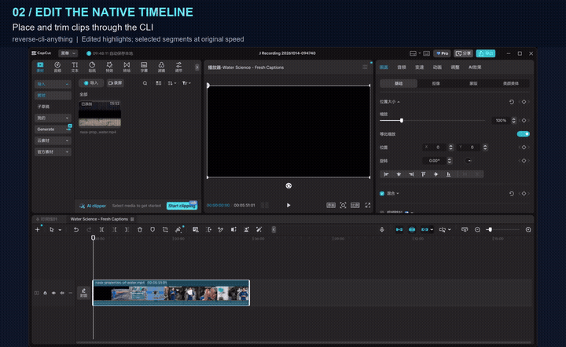
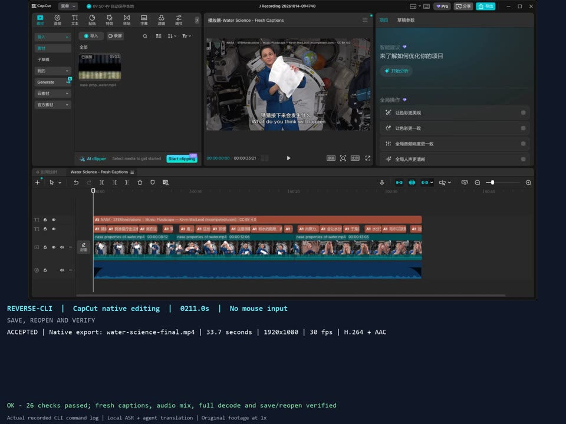
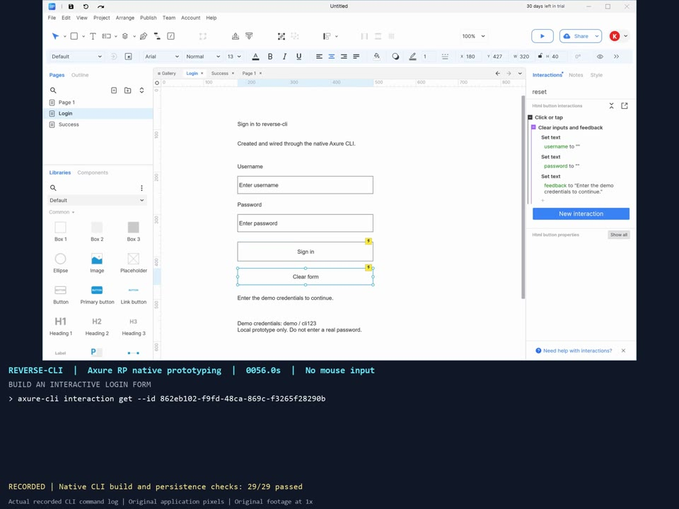
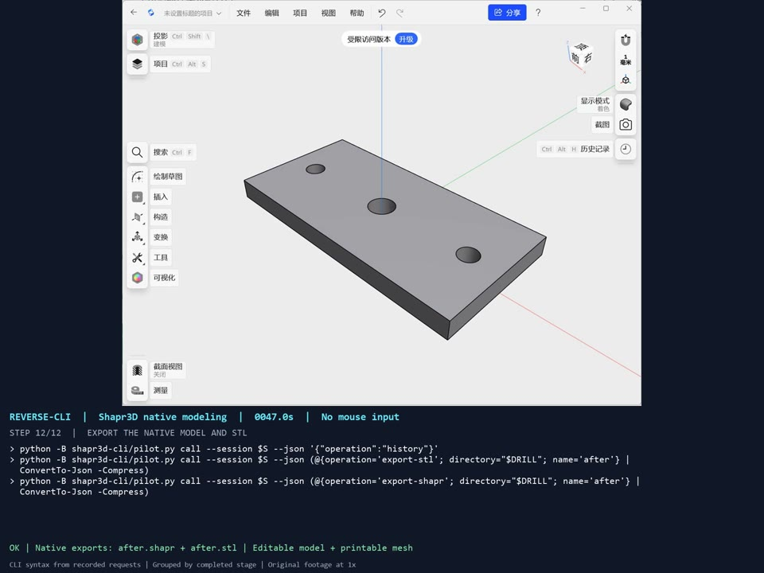

# reverse-cli-anything

**Turn closed-source software into agent-friendly CLI tools.**

[中文](README.zh-CN.md) · [Quick start](#quick-start-install-with-your-agent) · [Conversational use](#after-installation-create-and-use-clis-through-conversation) · [How it works](#how-it-works) · [Showcases](#showcase-examples) · [Developer docs](#development-and-extension) · [Acknowledgments](#acknowledgments)

**See it in action: native video editing in CapCut, driven through a CLI.**

[](https://github.com/leileqiTHU/reverse-cli-anything/raw/refs/heads/main/capcut-cli/assets/capcut-cli-45s.mp4)

**[45-second video · MP4 · 4.2 MB](https://github.com/leileqiTHU/reverse-cli-anything/raw/refs/heads/main/capcut-cli/assets/capcut-cli-45s.mp4)** · [Full CapCut workflow · 4:08](capcut-cli/assets/capcut-cli-demo.mp4) · [Axure + Shapr3D demos](#showcase-examples)

The MP4 link opens or downloads the video, depending on your browser. Selected recorded segments at their original speed; the GIF is a silent preview. CapCut's recovered internal calls drive editing and export; speech recognition and translation use external helpers. [Recording details](docs/demos/README.md#short-overview) · [Media credits](docs/demos/CREDITS.md).

`reverse-cli-anything` is a general reverse-engineering toolkit for agents. When an agent needs to work inside an application but its public CLI, API or MCP lacks the required operations, ask the agent to use this repository to investigate the software, recover its internal capabilities and build a set of callable, verifiable, reusable CLI tools.

**Have your agent install it once, then name the software and operations through conversation.** You interact through chat; the agent delivers tested CLI tools. The agent handles environment setup, reverse engineering, implementation and verification.

## When to use it

- Your agent needs to work inside an application whose public CLI, API or MCP lacks the required operations.
- You want a repeatable native workflow: creating documents, editing objects, changing parameters, importing assets or exporting results.
- You want to turn one successful reverse-engineering experiment into documented tools another agent can discover and use.

You choose the software and task. List the operations you need, or describe the outcome and let the agent identify the missing interfaces.

## Quick start: install with your agent

Use the code block's copy button and paste it into Codex or another coding agent with local terminal and filesystem access.

```text
Install and configure reverse-cli-anything: https://github.com/leileqiTHU/reverse-cli-anything.
Read the repository's generic Agent Skill and follow its installation guide
to configure and verify the setup. Where my agent supports installed Skills,
install the complete Skill with its referenced resources and verify discovery.
Respect my installation and storage preferences. Report the execution directory,
Skill path, installation record, discovery status and installation check results.
Install the repository only for now. Wait for me to name the software and
required operations in a later message before starting analysis or reverse engineering.
```

The agent follows the [installation guide](docs/install.md) to prepare the repository and Python 3.11+ and run the checks. Target applications and analysis tools are configured when a later task needs them.

## After installation: create and use CLIs through conversation

**First, describe the set of operations you need.** For example, send the agent a separate message:

```text
Use reverse-cli-anything to build a set of CLI tools for <application>
so you can perform <operation one>, <operation two> and <operation three>.
Check existing interfaces, then reverse-engineer, implement and test the missing capabilities.
Deliver reusable CLI tools with usage instructions and verify that they work together
in a complete workflow.
```

You can also describe a task: “I need you to accomplish `<goal>` in `<application>`. Use reverse-cli-anything to build the missing CLI tools needed for that work.” The agent breaks down the task, selects analysis tools, implements the interfaces and verifies them in the actual application.

**Once the tools are ready, keep assigning work through chat.** For example:

```text
Use the CLI tools you just built to process <input file or project> in <application>,
complete <specific task>, save the results to <output directory> and check the result.
```

You do not need to scaffold projects, register adapters or write commands manually. The agent follows [the target-task workflow](docs/SOP.md#start-a-target-task) and delivers commands, parameter documentation, a target Skill and actual test results. Later tasks can reuse the CLI tools; in a new agent or session, load the installed Skill or provide its path and the generated CLI location. The installation record identifies the framework configuration and registry to continue using.

## How it works

```text
Name the software and operations through chat
  → the agent checks existing interfaces and identifies gaps
  → investigates shipped artifacts and runtime to recover internal operations
  → implements the required CLI tools and verifies a complete workflow
  → delivers reusable tools for future agent tasks
```

The [generic Skill](skills/reverse-cli-anything/SKILL.md) and [SOP](docs/SOP.md) guide the agent's research and implementation. REA or tools suited to the target supply reverse-engineering capabilities. The repository provides the method and development tools; the agent researches, implements and verifies each new application's interfaces against the actual program.

| Stage | What the agent does |
| --- | --- |
| Define the task | Map the goal to operations, check existing interfaces and identify gaps requiring investigation. |
| Research and implement | Configure tools, inspect the program and runtime, recover internal calls and expose agent-friendly CLI tools. |
| Verify in the application | Execute the requested operations and complete workflow; check state, results and applicable save, reopen, export and recovery behavior. |
| Deliver and reuse | Supply the CLI, structured inputs and results, usage instructions, a target Skill, and verification status and limitations for each operation. |

The requested set of operations defines the delivery scope. Creating a directory or proving the first interface is an intermediate step. Each target's supported operations depend on actual verification; any unimplemented or blocked parts are explicitly identified.

### What the framework gives the agent

- **An engineering method:** eight stages from an operation gap to reusable delivery, with separate modes for building, extending, recovery and version upgrades.
- **Research guidance by artifact:** native commands and ABI, managed edit transactions, WinRT object lifetimes, embedded scripts, protocols and file formats. The agent loads only the relevant guides.
- **Persistent research records:** operation scope, entry-point contracts, experiments, build identity, observations and handoff templates. File-only helpers check dependencies and evidence references without treating static findings as proven capabilities.
- **A delivery framework:** adapter contracts, discovery, structured calls, retained receipts and recovery conventions, plus catalog-derived command documentation and self-contained Skill installation.

Start with the [engineering manual](docs/HARNESS.md) and select the guides for the target's runtime and required operations.

## Showcase examples

These examples demonstrate the method in practice; they are not a software support list or a prerequisite for installation or use. Three real workflows, operated without mouse clicks. Click a preview to open its MP4.

| CapCut · video editing | Axure RP · interactive prototyping | Shapr3D · native CAD modeling |
| --- | --- | --- |
| [](capcut-cli/assets/capcut-cli-demo.mp4) | [](axure-cli/assets/axure-cli-demo.mp4) | [](shapr3d-cli/assets/shapr3d-cli-demo.mp4) |
| **[Watch · 4:08](capcut-cli/assets/capcut-cli-demo.mp4)** | **[Watch · 1:46](axure-cli/assets/axure-cli-demo.mp4)** | **[Watch · 0:56](shapr3d-cli/assets/shapr3d-cli-demo.mp4)** |
| Empty project → real footage → trimming → fresh speech recognition and translation → music and captions → native MP4. Includes the finished video with audio. | Empty document → pages, buttons and inputs → layout and click rules → save and cold reopen → native HTML and real browser interaction. | Empty model → sketch import → native extrusion → thickness and hole-spacing edits → center through-hole → native project and STL export. |
| [Commands and setup](capcut-cli/README.md) · [26 native/media checks](capcut-cli/evidence/recorded-real-media-20261014.json) | [Commands and setup](axure-cli/README.md) · [29 native checks](axure-cli/evidence/native-login-acceptance.json) + [14 browser checks](axure-cli/evidence/native-login-browser.json) | [Commands and setup](shapr3d-cli/README.md) · [78 geometry checks](shapr3d-cli/evidence/recorded-demo-english-20261014.json) |

Footage is reused at its original speed. CapCut and Axure command captions come from timed execution logs; Shapr3D displays CLI equivalents of verified native requests. [Recording details, chapters and checksums](docs/demos/README.md) · [Media credits](docs/demos/CREDITS.md).

### Capabilities demonstrated in the examples

| Adapter | Implemented capabilities | Tested environment |
| --- | --- | --- |
| **[CapCut](capcut-cli/README.md)** | Create/open/close projects; import media; create and switch independent timelines; place, trim and split clips; add music and editable captions; change clip properties; inspect frames and intervals; export with CapCut's renderer. | Windows x64 · **9.5.0.4050** |
| **[Axure RP](axure-cli/README.md)** | Create/switch pages; add paragraphs, buttons and inputs; edit text, position and size; install supported click conditions/actions; undo/redo; save and cold reopen; generate native HTML. | Windows x64 · **11.0.0.4150** |
| **[Shapr3D](shapr3d-cli/README.md)** | Create a native project or attach to an editable open model; import .shapr/DXF; inspect/edit numeric history; perform the demonstrated extrusion, hole-face moves and circular cut; save/export .shapr and native Low-resolution STL. | Windows x64 · **26.180.11926.0** · scoped modeling pilot |

CapCut's recorded speech recognition and agent translation feed its native caption tools; those language-processing steps are external helpers. Shapr3D's visible modeling demonstration is scoped to the XY mounting plate: arbitrary sketch construction and general project navigation are not claimed. Each adapter documents its supported operations and lifecycle restrictions.

### How the example interfaces were recovered

The core editing capabilities in all three examples come from reverse engineering shipped application artifacts and wrapping recovered internal calls in our own CLI. Existing internal interfaces and publicly supported automation APIs are different things; the table identifies what each adapter recovers and reuses.

| Adapter | How the CLI reaches the application | What is reused and where the boundary lies |
| --- | --- | --- |
| **CapCut** | Analyze `lyra_cli_client.dll`, editor and frontend modules; use Frida to call internal commands, function addresses and active editing sessions. | **An internal command execution layer already exists.** We recover its calling conventions and connect it to project, timeline and export lifecycles. We do not claim to have created every underlying command from scratch. [Implementation](capcut-cli/docs/implementation.md) |
| **Axure RP** | Decompile the shipped assemblies to recover editing transactions, widgets, persistence and HTML generation; execute those calls on the UI thread through our own bridge. | **Some read-only operations reuse built-in MCP document-service components**, including the sitemap. Page creation, widget edits and interaction installation use recovered internal editing entry points. [Reverse-engineering evidence](axure-cli/reverse-engineering.md) |
| **Shapr3D** | Analyze shipped binaries and WinMD metadata to recover application C++/WinRT interfaces, vtables and selected function addresses; call native modeling objects inside the process. | DXF is an existing import format, and Windows thread dispatch is a standard platform facility. Modeling operations, parameter edits and object lifecycles are driven through the recovered internal bridge. [Native bridge](shapr3d-cli/native_bridge.js) |

An exported binary symbol, type metadata or an internal command is not by itself a supported third-party SDK. The reverse-engineering work establishes the parameters, object state, threading and lifecycle requirements needed to turn those entry points into usable, verifiable agent tools.


## Development and extension

These documents are for the agent performing the work and for framework contributors. Installation, self-check, scaffolding and registration commands live in the developer guides; users can follow the conversational flow above.

| Document | Contents |
| --- | --- |
| [Installation](docs/install.md) · [Generic Skill](skills/reverse-cli-anything/SKILL.md) | Environment preparation and task instructions for the agent. |
| [Engineering manual](docs/HARNESS.md) · [Workflow modes](docs/workflows.md) | Phase deliverables and decisions for building, extending, recovering and upgrading. |
| [Research guides](docs/HARNESS.md#loading-map) · [Templates](templates/research/README.md) | Technology-specific investigation, entry-point cards, experiments and handoff records. |
| [Development helpers](docs/development-tools.md) | Research workspaces, file fingerprints, evidence checks, command docs and complete Skill bundles. |
| [SOP](docs/SOP.md) · [Architecture](docs/architecture.md) | General research workflow and the responsibilities of the core and target adapters. |
| [Runtime commands](docs/runtime.md) · [Adapter contract](docs/adapter-contract.md) | Configuration, scaffolding, registration, invocation, receipts and tool structure. |
| [Acceptance criteria](acceptance/README.md) | Framework checks, native postconditions, persistence, output and recovery requirements. |
| [Contributing](CONTRIBUTING.md) | Extending the framework or adding a new application adapter. |

Shared capabilities live in `reverse_cli/`, `skills/reverse-cli-anything/`, `docs/` and `tools/`; application-specific implementations live in their own `<software>-cli/` directories. Showcases are indexed separately in `examples/`. Installation and the general workflow do not depend on any example.

## Acknowledgments

We owe thanks to the projects and authors whose ideas, tools and published work helped shape this repository.

| Project / author | Contribution to reverse-cli |
| --- | --- |
| [CLI-Anything](https://github.com/HKUDS/CLI-Anything) · [@HKUDS](https://github.com/HKUDS) | Inspiration for making software accessible to agents through CLI tools, and for organizing a reusable method alongside application examples and Skills. |
| [REA](https://github.com/morluto/rea) · [@morluto](https://github.com/morluto) | Agent-accessible reverse-engineering tools used in our investigation of shipped application artifacts and selected native entry points. |
| [OpenChatCut](https://github.com/0xsline/OpenChatCut) · [@0xsline](https://github.com/0xsline) | Conversational video-editing inspiration and a reference for useful agent editing operations, captions, audio and timeline inspection. |
| [capcut-cli](https://github.com/renezander030/capcut-cli) · [@renezander030](https://github.com/renezander030) | A comparison reference for CapCut automation through draft files, helping clarify the scope of our in-process native editing approach. |
| [shapr3d-mcp](https://github.com/Alfredoalv13/shapr3d-mcp) · [@Alfredoalv13](https://github.com/Alfredoalv13) | A research reference for agent-driven CAD through external modeling and STEP exchange, informing our investigation of native editable modeling operations. |

The implementation and demonstrations also rely on these open-source tools:

- [Ghidra](https://github.com/NationalSecurityAgency/ghidra), [ILSpy](https://github.com/icsharpcode/ILSpy), [Capstone](https://github.com/capstone-engine/capstone) and [Frida](https://github.com/frida/frida): native/managed analysis, disassembly and runtime instrumentation.
- [FFmpeg](https://ffmpeg.org/), [faster-whisper](https://github.com/SYSTRAN/faster-whisper) and [Windows Capture](https://github.com/NiiightmareXD/windows-capture): media preparation and validation, speech transcription and recording.

Thanks also to NASA for the demonstration footage and to Kevin MacLeod for *Fluidscape*. Sources, licenses and required attribution are retained in [media credits](docs/demos/CREDITS.md). Application documentation and additional research sources are linked in the [candidate research](docs/research/closed-source-shortlist-20261013.md), [earlier comparison](docs/research/next-example-20261013.md) and individual implementation notes.

## License

The project's original code and documentation are available under the [MIT License](LICENSE). Third-party software and media retain their respective licenses; see the acknowledgments above and [media credits](docs/demos/CREDITS.md).
