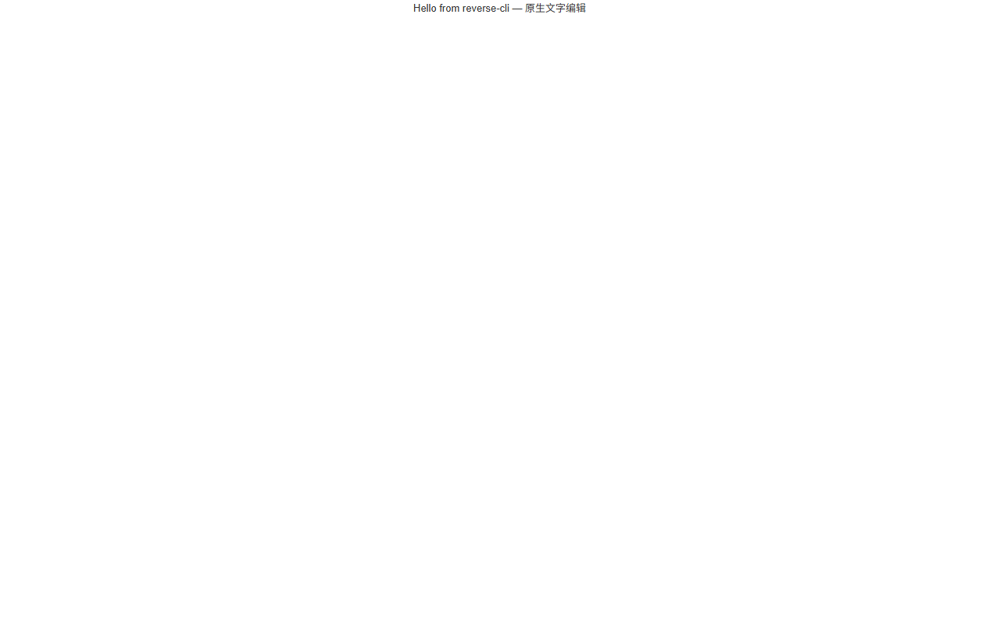
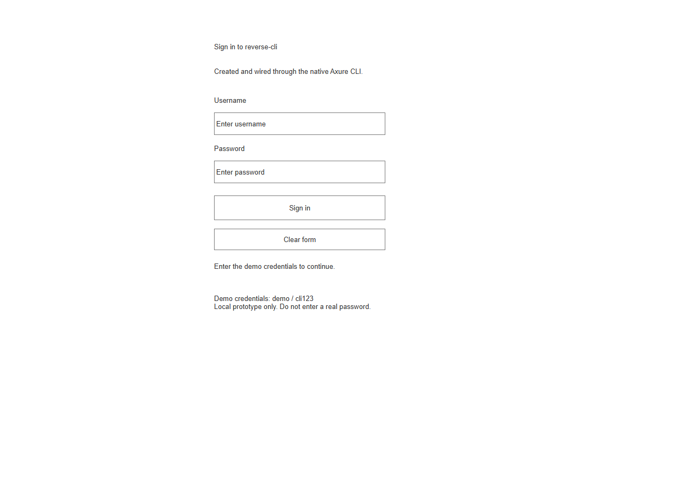

# Axure RP CLI

[Native prototype automation and evidence (English)](../docs/native-automation-examples.md#axure-rp-automation-generate-editable-prototypes-and-interactive-html) · [原生原型自动化与证据](../docs/native-automation-examples.zh-CN.md#axure-rp-自动化生成可编辑原型和交互-html)

**Axure RP prototyping automation through a JSON CLI for AI agents.** This reverse-cli-anything example creates pages and widgets, installs supported click interactions, saves and reopens native projects, and generates interactive HTML through recovered internal editing calls. Verified with Axure RP 11.0.0.4150 on Windows. [Project overview](../README.md) · [Automation FAQ](../docs/faq.md).

**[Watch the English CLI demo · 1:46](assets/axure-cli-demo.mp4)** — build an interactive login prototype, cold reopen the native project, export HTML and verify it in a browser. [Shared demo gallery and provenance](../docs/demos/README.md).

Windows 上的 Axure RP **11.0.0.4150** 原生编辑试验。Agent 可以创建和切换页面，添加按钮及输入框，修改位置尺寸和文字，安装点击条件与动作，撤销/重做、保存/重开，并调用 Axure 自己的 HTML 生成器。

完整链路为：**JSON CLI → 当前用户命名管道 → .NET startup hook → Axure UI 线程 → 原生编辑事务、保存器和生成器**。

## 已完成验收

[机器验收记录](evidence/native-text-acceptance.json)覆盖文字替换、撤销/重做、未保存项目保护、保存后切换文档重开、关闭进程后冷启动重开、继续编辑、原生 HTML 导出与 D 盘缓存设置。[浏览器验收记录](evidence/native-html-render.json)确认导出页包含完整中英文且实际渲染成功。



登录表单扩展通过 [29 项原生验收](evidence/native-login-acceptance.json)和 [14 项浏览器验收](evidence/native-login-browser.json)：空字段提示、错误凭据提示、正确演示凭据跳转 Success、返回 Login、清空输入及反馈。页面、控件 GUID、矩形及原生交互表达式在保存重开和进程冷启动后完全一致。旧文字流程的 24 项检查也通过。



[从空白工程开始的完整 MP4](assets/axure-cli-from-blank.mp4)包含实际 CLI 命令字幕、原生编辑、冷启动重开及浏览器交互；[录制及解码证据](evidence/login-recording.json)记录章节、帧数和哈希。录制是重新执行验收流程得到的真实画面，原生窗口按 15 fps 采集，浏览器约 5 fps 采样后编码为 15 fps；在进程重启和浏览器切换处拼接，不加速，无音轨。

工程编辑和保存全部由 CLI 执行，没有鼠标点击。导出页通过代码填入演示值、键盘 Enter 激活原生按钮；没有改写导出的 HTML 或注入业务规则。首次账号登录由用户完成。演示凭据为 `demo / cli123`，这是本地交互原型，无真实认证后端。

## 本机路径和启动

- 软件：`D:\Apps\Axure\Axure RP 11`
- 官方免安装包：`D:\Installers\Axure\AxureRP-Setup.zip`
- 原生缓存设置：`D:\Caches\Axure\Application`
- 进程 TEMP/TMP：`D:\Caches\Axure\Temp`
- 项目及 HTML：本目录 `outputs/`，完整实际路径见验收 JSON
- 桥接程序集、IPC 状态及请求记录：本目录 `.runtime/`

使用官方[手动安装方式](https://docs.axure.com/axure-rp/reference/installing-on-windows/)部署，Windows 可执行文件的 Axure 数字签名验证通过。启动时检查 `AxureRP11.dll` 的 SHA-256：

```text
dae5748f6be3e69c063ef117bab0b400586d94adf119f5a9ba260df59dc4e4a7
```

需要 PowerShell 7.6/.NET 10 编译桥接程序集，以及已有的 Python 3。此机器复用已有 Python；可用 `REVERSE_CLI_PYTHON` 指定其他解释器。首次使用需按 Axure 正常流程激活试用或订阅。

```powershell
# 在仓库根目录执行。
pwsh -File .\axure-cli\build.ps1
.\axure-cli\axure-cli.ps1 launch
.\axure-cli\axure-cli.ps1 status
.\axure-cli\axure-cli.ps1 capabilities
```

`DOTNET_STARTUP_HOOKS` 只设置在这次启动的子进程环境中。必须从 `launch` 启动才能连接桥接；已经从普通快捷方式打开的进程不支持直接接管。编译后的更新在下次启动生效。`launch --project D:\path\file.rp` 支持冷启动直接打开项目。

## 一条完整工作流

```powershell
.\axure-cli\axure-cli.ps1 project new
.\axure-cli\axure-cli.ps1 widget create --name "Heading" --text "Original text"
.\axure-cli\axure-cli.ps1 widget list

# 用 create/list 返回的 GUID 替换 <widget-id>。
.\axure-cli\axure-cli.ps1 widget text --id "<widget-id>" --text "Hello — 原生文字编辑"
.\axure-cli\axure-cli.ps1 undo
.\axure-cli\axure-cli.ps1 redo
.\axure-cli\axure-cli.ps1 project save --path "D:\ChatGPT\reverse-cli\axure-cli\outputs\demo.rp"
.\axure-cli\axure-cli.ps1 export html --output "D:\ChatGPT\reverse-cli\axure-cli\outputs\demo-html"
.\axure-cli\axure-cli.ps1 project close
.\axure-cli\axure-cli.ps1 launch --project "D:\ChatGPT\reverse-cli\axure-cli\outputs\demo.rp"
.\axure-cli\axure-cli.ps1 inspect
```

所有命令输出 JSON，成功退出码为 0，失败为 1。`widget text` 返回修改前后文字和 dirty 状态。`project sitemap` 复用应用内置的只读文档服务。

## 页面、布局和交互

```powershell
.\axure-cli\axure-cli.ps1 page create --name Login
.\axure-cli\axure-cli.ps1 page list
.\axure-cli\axure-cli.ps1 page open --id "<page-id>"
.\axure-cli\axure-cli.ps1 widget create --kind input --name username --placeholder "Enter username" --x 180 --y 210 --width 320 --height 42
.\axure-cli\axure-cli.ps1 widget create --kind input --name password --password --placeholder "Enter password" --x 180 --y 300 --width 320 --height 42
.\axure-cli\axure-cli.ps1 widget create --kind button --name submit --text "Sign in" --x 180 --y 365 --width 320 --height 46
.\axure-cli\axure-cli.ps1 widget bounds --id "<widget-id>" --x 200 --y 380 --width 340 --height 48
.\axure-cli\axure-cli.ps1 interaction set --id "<button-id>" --spec "D:\path\click.json"
.\axure-cli\axure-cli.ps1 interaction get --id "<button-id>"
```

`page create` 不自动切换页面；返回精确名称及稳定 GUID。页面创建和重命名组成一次原生撤销事务，重复名称会在修改前拒绝。`widget create` 支持 `paragraph`（默认）、`button`（原生 HTML Button）及 `input`，坐标单位是 Axure 文档像素。`widget bounds` 可以只提供部分属性；宽高必须在 1–20000，坐标在 −10000–20000，非有限值被拒绝。

交互规格为 UTF-8 JSON，例如：

```json
{
  "event": "click",
  "cases": [
    {
      "name": "Empty username",
      "when": {"widget": "<username-id>", "equals": ""},
      "actions": [{"type": "setText", "target": "<feedback-id>", "text": "Enter username."}]
    },
    {
      "name": "Continue",
      "actions": [{"type": "navigate", "page": "<success-page-id>"}]
    }
  ]
}
```

条件支持输入框文字 `equals`，以及 `{"any":[...]}` / `{"all":[...]}` 组合。分支为 if / else-if / else，省略 `when` 的分支必须在最后。`setText` 已验收段落和输入框；`navigate` 跳转同一项目页面。所有控件引用必须属于当前页面。`interaction get` 从真实原生对象树返回条件与动作，不是回显请求文件。

本轮只允许向**空交互表**安装规则，已有交互会被拒绝，防止覆盖其他事件；可立即 `undo` / `redo`。不支持替换任意已有规则、动态面板、复杂富文本、其他事件或 Axure `[[...]]` 内联表达式。每个控件限制 20 个分支，每分支 20 个动作。

`project new/open/close` 遇到未保存修改会拒绝执行；先调用 `project save`。另存为拒绝覆盖其他已有文件；HTML 导出要求目标目录为空。相同文件路径的 `project open` 可能被应用当作无操作；验收会先切换到空白文档，并额外执行进程冷启动重开。

```powershell
.\axure-cli\axure-cli.ps1 settings cache --path "D:\Caches\Axure\Application"
# 缓存更改在保存、关闭、重新 launch 后生效；不移动已有数据。
```

首次启动在 C 盘创建的少量设置/备份已保留；重启后新的原生工作目录验证位于 D 盘。注册表偏好项仍由 Windows 管理。

## 复现验收

```powershell
$py = $env:REVERSE_CLI_PYTHON
# 将 $py 指向有效 Python；CLI 已启动且当前项目已保存。
& $py .\axure-cli\acceptance.py
& $py .\axure-cli\verify_html.py
# 新登录表单闭环：
& $py .\axure-cli\acceptance_login.py
node .\axure-cli\verify_login.mjs
# 同时录制新一轮真实流程：
$env:AXURE_RECORD_DEMO='1'
& $py .\axure-cli\acceptance_login.py
node .\axure-cli\verify_login.mjs
& $py .\axure-cli\finalize_recording.py
Remove-Item Env:AXURE_RECORD_DEMO
```

验收脚本通过公开 CLI 创建独立测试项目，会替换当前已保存的活动文档。每轮输出到新的时间戳目录。浏览器验证复用已安装 Chrome，通过临时本地 HTTP 服务渲染；专用浏览器配置和缓存放 D 盘。

登录浏览器验收使用 Node 22+ 内置 WebSocket，无 npm 依赖。录制复用本仓库 D 盘已有 FFmpeg（`record_demo.py` 中 `FFMPEG` 路径），默认调整 Axure 窗口到 2800×1700，录制窗口画面及命令字幕。视频输出 1920×1280，原始浏览器帧放 `D:\Caches\Axure\Recordings`。Axure 的空输入提示由原生运行时用 input 值呈现，密码框开始输入后才切为 password 类型；验收依据这个实际行为检查。

## 逆向证据及范围

见[逆向入口与证据](reverse-engineering.md)。REA 完成 PE/CLI 识别和证据记录，但完整程序集触发其元数据表示上限；定向反编译由 ILSpy 补充，入口通过真实运行时验证。这里的“原生编辑”指 Axure 自身的编辑业务与撤销事务；Windows 版本采用托管 .NET 运行时。

当前范围：根级页面、当前页面上的 `VectorShape` 段落、原生 Button 和 TextBox、矩形布局，以及上述有限点击条件/动作。文字替换沿原生纯文本路径使用首个文字片段的格式，复杂富文本的多段样式不在保留承诺内。深层动态面板、自适应视图和其他控件类型尚未验收。

原生编辑需要桌面进程；当前没有无显示环境支持或写入 MCP 服务。未知/部分执行结果不自动重试。超时后查看 `requestId` 对应的 `.runtime/requests/<id>.json` 和 `inspect`，确认状态后再决定下一步。命名管道限制为当前 Windows 用户，正式接口只提供列出的业务命令。
