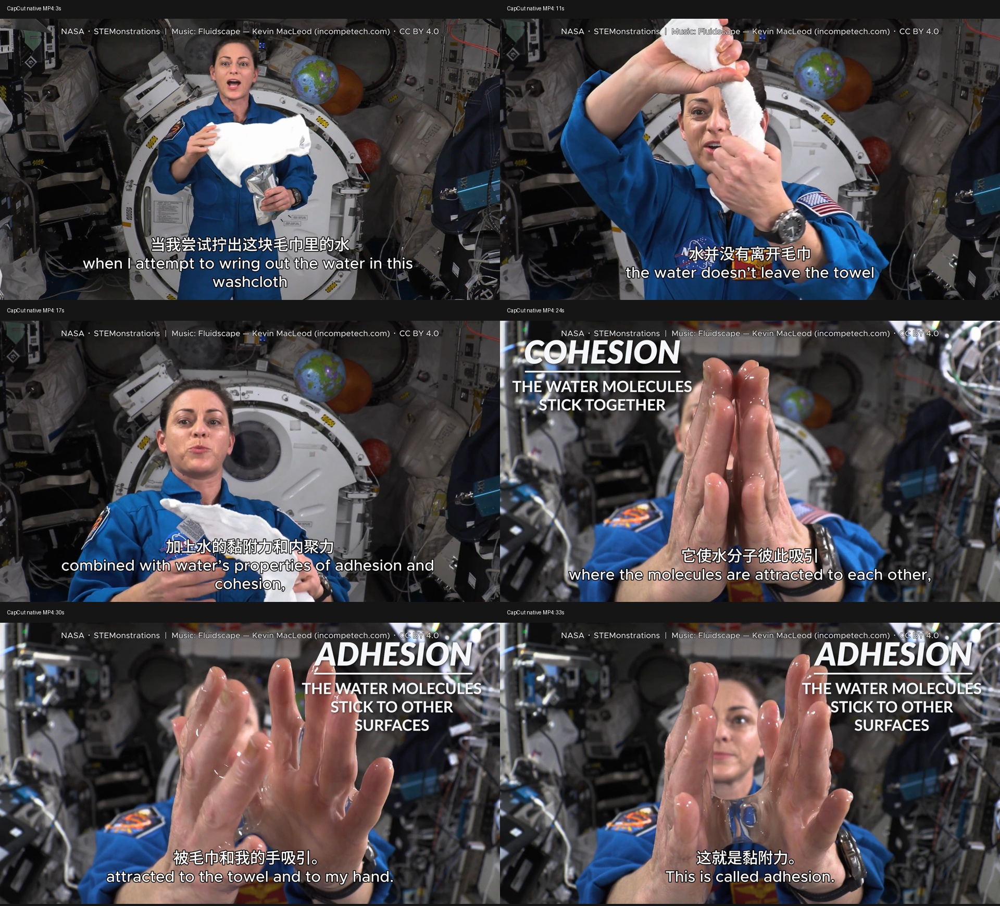

# 真实科普素材：从视频理解到 CapCut 原生输出

## 用户任务

选用有实际画面内容和人声的视频，依据画面与讲解剪辑、配乐、添加字幕，并通过 CLI 导出和验收。

## 素材与剪辑决定

原视频是 [NASA STEMonstrations: Properties of Water](https://www.nasa.gov/stem-content/stemonstrations-properties-of-water/)，宇航员 Nicole Mann 在空间站演示拧湿毛巾。对原片抽帧，并用本地 Whisper 转写实际人声，结合 NASA 官方字幕修正识别文本。

| 原片区间 | 成片区间 | 叙事作用 |
| --- | --- | --- |
| 193.8–202.2 秒 | 0–8.4 秒 | 提问：微重力下拧湿毛巾会怎样？ |
| 216.3–228.5 秒 | 8.4–20.6 秒 | 展示结果，解释微重力和水的性质共同起作用 |
| 229.1–242.2 秒 | 20.6–33.7 秒 | 水桥特写与内聚力、黏附力定义 |

删除片头、准备过程和其他章节，保留完整语句。第二段原生缩放 1.08 倍，第三段保留原片的科学术语标注。添加 16 条中英字幕和一条署名文字。

配乐是 Kevin MacLeod 的 [Fluidscape](https://incompetech.com/music/royalty-free/index.html?isrc=USUAN1100393)，采用源音乐 20–53.7 秒，-22 dB，首尾淡变。原 MP3 带封面，先用 FFmpeg CLI 解码成 WAV，再由 CapCut 音频 CLI 剪取和混音。视频、人声和音乐均为真实已有素材。

## 执行路径

CapCut CLI 完成项目创建、素材库导入、独立时间线、三次原生裁剪、片段属性、音乐、字幕、原生帧、原生 MP4 导出及关闭重开。FFmpeg 用于输入格式准备与独立验证，Whisper 用于语音理解及成片复核。没有鼠标或键盘 UI 自动化，没有通过离线拼接替代 CapCut 的成片渲染。

## 实际验收

- 33.7 秒，1920×1080，30 fps，H.264/AAC；1,011 帧完整解码。
- 3 段视频、1 段音乐、16 条字幕和署名，共 21 个原生可编辑对象，关闭重开后一致。
- 24 项验收全部通过；画面抽样与原素材、缩放预期和原生帧对应。
- 混音测量中音乐约低于人声 19–23 dB；无削波；独立成片 ASR 与参考字幕词差约 1.09%。
- 原用户 12 秒项目内容保持不变。

[可分发的验证摘要](../evidence/real-media-20261013.json)。完整本地证据在 `capcut-analysis/real-media-20261013/`；本机成片在 `exports/real-water-science-20261013.mp4`。这两个目录被忽略，不以不存在的在线下载地址替代。

## 来源与署名

Video: NASA, STEMonstrations: Properties of Water. [NASA media usage guidance](https://www.nasa.gov/nasa-brand-center/images-and-media/). The excerpt is edited; no NASA endorsement is implied.

Music: **Fluidscape — Kevin MacLeod (incompetech.com)**, licensed under [Creative Commons Attribution 4.0](https://creativecommons.org/licenses/by/4.0/). The music was excerpted, reduced in level and faded. The screenshot is from our edited native output.
